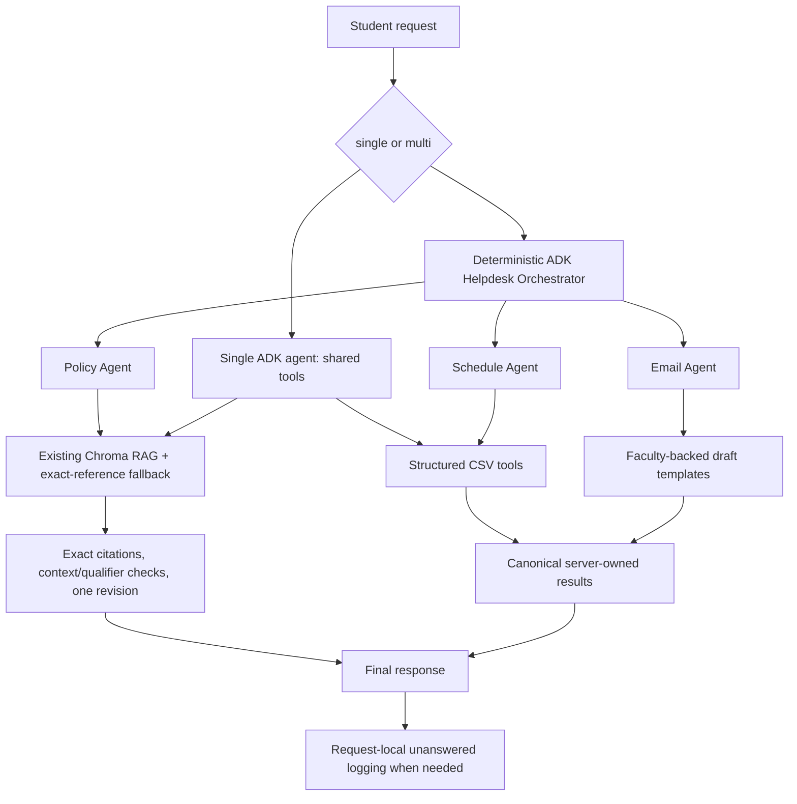

# IIT Jodhpur Multi-Agent Academic Helpdesk

A local academic helpdesk supporting policy evidence, course identity/offerings,
semester-specific faculty/slot lookups, unsent academic email drafts and safe abstention.
The assignment compares a single ADK agent with an orchestrator and three specialists.

## Architecture



Both modes share eight tools, the same source snapshot/index, local model settings
(temperature 0, context 8192, output cap 2400), exact citation checks and logging.
Multi specialists execute sequentially. Final composition uses validated Python
results; no final LLM rewrites policy citations or email drafts. Emails are never sent.
Model-generated student dates, names and diagnoses are not trusted.

Technology: Python 3.12, Google ADK, LiteLLM, Ollama, Qwen3 8B,
optional Llama 3.1 8B, ChromaDB, nomic-embed-text, PyMuPDF, CSV/SQLite,
pytest and matplotlib. Dependencies are pinned in requirements.txt.

## Dataset and limitations

The local source snapshot has 24 PDFs and 111 extracted pages, plus checked HTML
provenance for structured data. Nineteen extracted pages still need review.
The active development index contains 215 chunks, including flagged content.
Known records cover six offerings and nine instructor assignments in 2026-27-S1.
The timetable is empty and complete offering/category coverage is unavailable.
Missing rows do not prove an official zero. Policy applicability/currentness remains
unknown where not independently established; warnings are retained.

Use only authorized local documents. Some official listings are intranet-only.
Do not publish source PDFs, private records, .env, model weights, databases or raw
evaluation traces. See evaluation/DATA_REQUIREMENTS.md and the readiness report.
The manifest and existing source moves require a separate access/provenance review.

## Repository layout

- src/single_agent.py: baseline Runner/API and policy validation.
- src/agent.py: ADK entry point and mode selection.
- src/orchestration.py and src/agents/: coordinator and specialists.
- src/request_context.py: shared trusted request context and facts.
- src/tools/: RAG, CSV lookup, canonical rendering, drafts and logging.
- src/validation/: citations, source excerpts, tables, qualifiers and bounded repair.
- ingestion/: extraction, cleaning, chunking and indexing.
- evaluation/: fixed questions, source-pinned ground truth, runner, scorer and exports.
- tests/: offline regressions with isolated records and mocked inference.
- scripts/: source, hardware and submission verification.
- reports/: report, charts and verification outputs.

## Windows PowerShell setup

Install Python 3.12 and Ollama from the official Windows installer:
https://ollama.com/download/windows
Official Windows instructions: https://docs.ollama.com/windows

```powershell
py -3.12 -m venv .venv
.\.venv\Scripts\Activate.ps1
python -m pip install --upgrade pip
python -m pip install -r requirements.txt
Copy-Item .env.example .env
ollama list
```

The Ollama desktop app normally serves localhost:11434. If it is not running, start
`ollama serve` in a separate terminal. Do not start a duplicate server.

```powershell
ollama pull nomic-embed-text
ollama pull qwen3:8b
# Optional, required only for the four-configuration model comparison:
ollama pull llama3.1:8b
python -m evaluation.compare_models --check
```

All inference is local. The framework does not automatically install missing models.
Use one generation model at a time; the comparison command unloads competing chat
models and executes configurations sequentially.

### OCR and Poppler

Text extraction can require Poppler's pdftotext and Tesseract with matching language
traineddata for scanned documents. Install authorized Windows builds and add the
executables to PATH. Configure the actual tessdata directory as needed; do not copy a
Linux path into Windows. Reference:
https://pymupdf.readthedocs.io/en/latest/installation.html

```powershell
Get-Command pdftotext
pdftotext -v
tesseract --version
```

The Windows workflow is prepared but has not been executed on a Windows 16 GB laptop.
Run scripts.verify_hardware there and inspect its RSS/GPU measurements; they are
measurement proxies, not a substitute for checking actual target-machine behavior.

## Rebuild procedure (new paths; preserve existing experiment sources/index)

First ensure every manifest filename exists locally and its use is authorized.
Never rebuild an index in place while comparing experiments.

```powershell
python -m ingestion.extract_documents --output-dir data/processed/rebuild_extracted
python -m ingestion.clean_documents --input data/processed/rebuild_extracted/extracted_pages.jsonl --output-dir data/processed/rebuild_cleaned
python -m ingestion.chunk_documents --input data/processed/rebuild_cleaned/cleaned_pages.jsonl --output-dir data/processed/rebuild_chunked
python -m ingestion.build_vector_store --chunks data/processed/rebuild_chunked/chunks.jsonl --chroma-path data/vector_store_rebuild --include-review
```

--include-review explicitly creates a development index with warnings; it does not
certify OCR or table semantics. A new corpus/index is a new dataset snapshot.
For the preserved full-v1/full-v2 comparison, use the existing compatible snapshot.

## Run the helpdesk

```powershell
python -m src.single_agent --mode single --query "What are minor and major exam durations and minimum Major examination weightage?" --extractive --debug
python -m src.single_agent --mode multi --query "What are minor and major exam durations and minimum Major examination weightage?" --extractive --debug
python -m src.single_agent --mode multi --query "What is the slot for Autonomous Systems?" --semester "2026-27-S1" --debug
python -m src.single_agent --mode multi --program PG --semester "2026-27-S1" --query "I missed my Major exam in CSL7560 due to illness. Explain the makeup policy and draft an email to the instructor." --extractive --debug
```

For the ADK entry point src.agent.root_agent, set
`$env:HELPDESK_AGENT_MODE = "multi"` before starting ADK. Default is single.
Restart ADK after changing mode/model environment variables.
Missing timetable questions correctly return no verified record.

## Tests, readiness and hardware

```powershell
python -m pytest tests -q -p no:cacheprovider
python -m scripts.source_readiness
python -m ingestion.validate_structured_data --semester 2026-27-S1
python -m scripts.verify_hardware --live
python -m scripts.verify_submission --tests
```

Normal tests do not require live inference. --live hardware checks are explicit,
sequential and log to a temporary database. Readiness remains false while authorized
coverage is incomplete. Latest exact test results are recorded in
reports/submission_verification.json.

## Evaluation and reproducibility

The fixed benchmark has 30 questions: 10 policy, 8 schedule, 5 email, 4 out-of-scope,
3 unsupported. Nineteen are currently answerable. Three cases intentionally need
missing authoritative sources. Two requests require policy/email coordination.

```powershell
python -m evaluation.evaluate validate
python -m evaluation.compare_models --warmup --repetitions 3 --answer-mode extractive --output-dir evaluation/results/raw/full-v2-new
python -m evaluation.export_results --comparison evaluation/results/raw/full-v2-new --output reports/full-v2-new
```

Output directories must be new. Full-v1 is immutable, with preservation hashes in
reports/full_v1_preservation.json. The recorded full-v2 lives under
evaluation/results/raw/full-v2; do not rerun into that directory.

Inputs, source/application/grading hashes, model digest, settings, residency, warmup,
responses, tool arguments/outputs, citations, errors and stability are saved.
Raw results are ignored by Git. Matched parity in v2 does not make prompts or
coordination identical. V1 had a six-tool baseline, cold/warm imbalance and known
generation/validation defects; improvements cannot be attributed solely to orchestration.

Source identity, claim support, relevance, applicability, content correctness,
strict task completion and outer status are distinct. No similarity or model
self-review is accepted as authoritative grading. Human review is still needed.
The approximately 20 priority v1 records are in
evaluation/results/raw/review_support/full_v1_priority_human_review.json.

```powershell
Copy-Item evaluation/results/raw/full-v2-new/qwen3_8b-multi/review_template.json evaluation/results/raw/full-v2-new/qwen3_8b-multi/grades.json
# Independently review the pinned sources and fill reviewer, scores and notes.
python -m evaluation.evaluate grade --run-dir evaluation/results/raw/full-v2-new/qwen3_8b-multi --grades evaluation/results/raw/full-v2-new/qwen3_8b-multi/grades.json
python -m evaluation.compare_models --summarize evaluation/results/raw/full-v2-new
```

See evaluation/README.md for grading/rescoring details. Do not modify old experiments
to match a new rubric or dataset. AI-assisted reviews are labelled as such and do not
constitute independent human sign-off.

## Submission artifacts and findings

- reports/final_report.md and reports/final_report.pdf: actual methodology/results.
- reports/full_v2/: aggregate CSV, charts, stability and error triage.
- reports/data_readiness_full_v2.json: source hashes and coverage gaps.
- reports/hardware_verification.json: measured platform and optional live memory.
- reports/submission_verification.json: final gates and external blockers.

Full-v1 AI-assisted accuracy was 15/57 single and 36/57 multi. Read the final report
for actual full-v2 results, grading coverage and experiment limitations. No claim of
Llama quality, Windows certification or independently verified latest policy is made
without corresponding evidence.

Team contributions: [Member / implementation / data verification / evaluation /
independent grading]. Replace with actual contributions before submission.

Final selected live run: `evaluation/results/raw/full-v2/revision-2/`, pinned by
`evaluation/results/raw/full-v2/final_selection.json`. The first full-v2 attempt is
retained separately at the parent directory. AI-assisted accuracy: single54/57
(94.74%), multi57/57 (100%); not independent human verification. Single E05
remains incomplete; both modes have redundant P09 table excerpts rejected by the
evaluator, so claim support is below100%. See the report for denominators and caveats.
